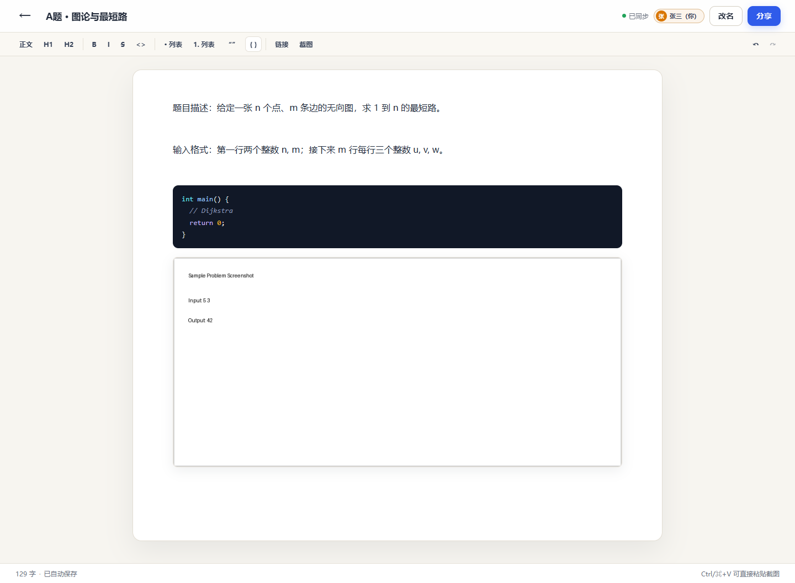

# LAN Pad · 局域网题目协作

一个给队内比赛用的轻量协作文档：**文字 + 代码块 + 截图 + 附件**，主机启动服务，队友用局域网链接打开即可一起编辑。

- 免登录、无账号；链接即房间
- 实时同步（Yjs + y-websocket）
- 自定义名字、颜色、在线状态和远端光标
- 代码块语法高亮 + 语言选择 + 复制
- 截图 `Ctrl/⌘+V` 粘贴、拖拽或选择文件；点击放大
- 附件 `Ctrl/⌘+V` 粘贴、拖拽或工具栏选择，最大 50MB；压缩包/PDF/Office/代码等不同类型显示不同图标
- 支持从网页、Word、WPS、聊天工具直接复制图文混排，图片自动上传
- SQLite 持久化，重启不丢；图片和附件存本地
- 首页可删除文档（需要主机密钥，软删除）
- Windows 上 `npm start` 或双击 `start.bat`
- 可打包成单个 `LANPad.exe`：别人下载后双击即用，不需要安装 Node



设计方案（调研、架构、取舍）见 [design.md](design.md)。

---

## Go 版本（`feat/go-rewrite` 分支）

后端已经翻写为纯 Go（[ygo](https://github.com/Deln0r/ygo) + modernc SQLite），前端保留 React + Tiptap：

```bash
npm run build            # 构建前端
go run ./cmd/lanpad      # 启动 Go 服务（从 dist/client 读前端）

# 或者编译单文件 exe（前端已内嵌）
npm run go:build         # 生成 release/LANPad.exe（约 12 MB）
./release/LANPad.exe
```

- 运行时不需要 Node；单文件 exe 也不需要 `dist/client`，双击即可启动
- 数据格式与 Node 版兼容，可以直接打开旧的 `data/lanpad.db`
- 实时协议由 Hocuspocus 换成 y-websocket，前端已适配；`?mode=view` 改为服务端强制只读
- 版本历史：自动快照、哈希/大小、行级差异对比、恢复并支持 `Ctrl+Z` 撤销
- 详细的模块对照、差异与待办见 [docs/go-rewrite.md](docs/go-rewrite.md)

---

## 环境要求

- **Go 1.26+**：后端运行时；`npm start` 等同于 `go run ./cmd/lanpad`
- **Node.js ≥ 22.12**：只用于构建前端（`npm install` / `npm run build`）；日常运行不需要 Node
- Windows 10/11 / macOS / Linux 均可作为主机
- 队友只需要 Chrome / Edge / Firefox 等现代浏览器
- 主机和队友在同一局域网

> Go 后端使用纯 Go 的 SQLite（modernc.org/sqlite），不需要 CGO；前端构建产物在 `dist/client/`，由 Go 服务直接托管。

---

## 快速开始

```bash
npm install      # 构建前端需要
npm run build    # 生成 dist/client
npm start        # go run ./cmd/lanpad
```

启动后控制台会打印：

```text
本机访问:   http://localhost:8787
局域网访问: http://192.168.x.x:8787
主机密钥:   ...
```

把“局域网访问”地址发给队友即可。也可以直接双击 `start.bat`（会检查前端产物并用 Go 启动）。

### 单文件 exe（旧 Node 方案，保留作参考）

`scripts/build-exe.mjs` 里的 Node SEA 打包是翻写前的方案，现已由 Go 后端取代；
Go 版本的构建命令是 `npm run go:build`，产物是内嵌前端的单文件 `release/LANPad.exe`。
下面是旧 Node 方案的说明。

```bash
npm run build:exe
```

产物是 `release/LANPad.exe`（约 85 MB），里面已经包含 Node 运行时、服务端和前端静态文件。
把它发给其他 Windows 机器，**双击即可启动**，对方不需要装 Node、npm，也不需要 `npm install`。

接收方的使用方式：

1. 把 `LANPad.exe` 放到有写权限的目录（桌面、D 盘等；不要放 `C:\Program Files`）。
2. 双击运行。首次启动 Windows 防火墙会弹窗，勾选“专用网络”并允许。
3. 控制台会显示本机地址、局域网地址和主机密钥，并自动打开浏览器。
4. 数据（SQLite、截图、`host-key.txt`）自动创建在 **exe 同目录的 `data/`**，整个文件夹拷走即可备份/迁移。
5. 控制台窗口保持打开；关掉窗口服务就停止。队友打不开时先看窗口里的局域网地址和防火墙提示。

打包后的行为与旧 Node 版 `npm start` 一致，另外还有：

- 可用 exe 同目录的 `.env` 配置 `PORT` / `HOST` / `DATA_DIR` / `PUBLIC_BASE_URL` / `HOST_KEY`；
- `LANPAD_OPEN=0` 可关闭启动时自动打开浏览器（例如设成开机自启）；
- 端口被占用时会提示，不会一闪而过；
- 升级：直接用新 exe 覆盖旧 exe，保留 `data/` 即可。

注意事项：

- exe 只能在 **Windows x64** 上运行，架构跟随构建机（当前是 node.exe 的架构）；macOS/Linux 需要各自的构建产物。
- 未做代码签名，首次运行可能被 SmartScreen 拦一下，点“更多信息 → 仍要运行”；企业环境可以用自己的证书签名。
- 防火墙规则按**程序**放行即可；如果按端口放行，规则见下面的 [Windows 防火墙](#windows-防火墙)。
- 图标沿用 Node 默认图标；需要品牌图标可以在构建后追加资源编辑步骤。
- 分发时只需要 `LANPad.exe` 一个文件；`data/` 是运行后生成的，不要一起发（除非是要迁移已有数据）。

### 开发模式

```bash
npm run dev
```

- 前端：<http://localhost:5173>
- 后端/WS：<http://localhost:8787>
- Vite 已配置 `/api`、`/assets`、`/collab` 代理

### 环境变量

复制 `.env.example` 为 `.env`，按需修改：

```ini
PORT=8787
HOST=0.0.0.0
DATA_DIR=./data
# PUBLIC_BASE_URL=http://192.168.1.23:8787
# HOST_KEY=...
```

- `PUBLIC_BASE_URL`：自动探测的 IP 不对时，手动指定复制出去的地址。
- `HOST_KEY`：主机密钥；不填则首次启动自动生成到 `data/host-key.txt`。

---

## 使用方式

1. 主机打开首页，点“新建文档”。
2. 点“分享”，复制带本机 IP 的链接，发到群里。
3. 队友打开链接，第一次会弹窗填名字；之后自动记住。
4. 正文里可以直接：
   - 输入文字，或用工具栏加粗/标题/列表/引用；
   - 点“代码块”，选择 C++ / Python / Java 等语言；
   - `Ctrl/⌘+V` 粘贴截图，或把图片拖进正文；
   - 从网页/Word/WPS 复制“文字 + 图片”直接粘贴，图片会自动上传；
   - 点击图片打开灯箱，`Esc` 关闭。
5. 顶部会显示在线队友、颜色、同步状态。

> `?name=红队-01` 可以给固定电脑预填名字；`?mode=view` 是只读查看（v0.1 仅前端约束，不是安全边界）。

---

## Windows 防火墙

首次启动 Windows 可能弹窗，勾选“专用网络”。如果队友打不开，用管理员 PowerShell 执行：

```powershell
New-NetFirewallRule `
  -DisplayName "LAN Pad 8787" `
  -Direction Inbound `
  -Protocol TCP `
  -LocalPort 8787 `
  -Action Allow `
  -Profile Private `
  -RemoteAddress LocalSubnet
```

或：

```bat
netsh advfirewall firewall add rule name="LAN Pad 8787" dir=in action=allow protocol=TCP localport=8787 remoteip=LocalSubnet profile=private
```

如果当前网络被识别为“公用网络”，把网络改为“专用”，或临时把规则改成 `-Profile Any`（确认现场网络可信）。

排查顺序：

1. 两台电脑是否同一网段（`ipconfig` 对比前三位）。
2. 队友能否 `ping 192.168.x.x`。
3. 防火墙是否放行 8787。
4. 是否连了 VPN / 虚拟机网卡，首页选错 IP。
5. 路由器是否开了 AP 隔离/客户端隔离。
6. 公司 Wi-Fi 是否禁止终端互访。

---

## 数据、备份与主机操作

```text
data/
├─ lanpad.db          # SQLite：文档、版本、图片/附件元数据
├─ host-key.txt       # 主机密钥
└─ assets/<docId>/    # 截图和附件文件
```

- 比赛结束后直接复制整个 `data/` 目录归档。
- 恢复：停服务，替换 `data/lanpad.db`，再启动。
- 不要把 `data/` 放在 OneDrive/坚果云同步目录，SQLite WAL 容易被锁坏。
- 删除文档（软删除）需要主机密钥：

```bash
curl -X DELETE \
  -H "X-Host-Key: <data/host-key.txt 里的值>" \
  http://127.0.0.1:8787/api/docs/<docId>
```

v0.1 首页文档卡片右侧已经有“删除”按钮：第一次删除会提示输入主机密钥，校验通过后软删除并从列表移除，密钥保存在当前标签页的 `sessionStorage` 里。队友没有密钥，不能删文档。

---

## 本地验证脚本

已带几条无需浏览器的 smoke test：

```bash
# 两个 Yjs 客户端实时同步
node scripts/test-sync.mjs <docId>

# 重新连接并读取 SQLite 中的内容
node scripts/test-load.mjs <docId>

# 浏览器 E2E（需要本机 Chrome + 已启动服务）
node scripts/test-browser.mjs

# 首页/截图粘贴/只读模式
node scripts/test-ui.mjs

# 在线人数
node scripts/test-online.mjs

# 服务重启 + 客户端重连
node scripts/test-reconnect.mjs

# 真实剪贴板图片粘贴（Playwright）
node scripts/test-clipboard.mjs

# 富文本 + 多图混合粘贴
node scripts/test-mixed-paste.mjs

# Go 服务端：附件粘贴/图标/同步/下载
BASE_URL=http://127.0.0.1:8787 node scripts/test-attachments.mjs

# 版本历史差异/恢复
BASE_URL=http://127.0.0.1:8787 node scripts/test-history.mjs
```

浏览器脚本默认使用 `C:\Program Files\Google\Chrome\Application\chrome.exe`，可用 `CHROME_PATH` 覆盖；服务地址可用 `BASE_URL` 覆盖。

---

## 主要接口

| 方法 | 路径 | 说明 |
|---|---|---|
| `GET` | `/api/health` | 健康检查 |
| `GET` | `/api/network` | 本机局域网地址 |
| `GET` | `/api/docs` | 文档列表 |
| `POST` | `/api/docs` | 新建文档 |
| `GET` | `/api/docs/:id` | 文档元数据 |
| `DELETE` | `/api/docs/:id` | 软删除（需 `X-Host-Key`） |
| `POST` | `/api/docs/:id/assets` | 上传截图（≤15MB） |
| `POST` | `/api/docs/:id/attachments` | 上传附件（≤50MB） |
| `GET` | `/api/docs/:id/versions` | 版本历史列表 |
| `POST` | `/api/docs/:id/versions` | 立即保存快照 |
| `GET` | `/api/docs/:id/versions/:versionId` | 版本详情 |
| `GET` | `/assets/:docId/:filename` | 读取截图/附件 |
| `WS` | `/collab/:docId` | Yjs + awareness 同步 |

---

## 目录结构

```text
cmd/lanpad/main.go   Go 入口（配置、监听、优雅退出、自动开浏览器）
internal/
  config/            环境变量 / .env / 数据目录 / host-key
  docstore/          SQLite：docs / versions / assets / doc_updates
  collab/            ygo 同步服务器、在线人数、只读
  assets/            图片/附件校验、命名、SHA-256、落盘
  web/               REST API、图片/附件、静态前端
  network/           局域网 IP 探测
  ids/               文档 ID / 文件名校验
  openbrowser/       跨平台打开浏览器
src/
  App.tsx            路由
  components/        首页、文档页、工具栏、历史、附件卡片、弹窗
  editor/            Tiptap attachment 节点
  api.ts             前端 API
  styles.css         全部样式
scripts/             测试、build-go.mjs（Go 单文件打包）
server/              旧 Node 实现，仅作参考
design.md            设计方案
docs/go-rewrite.md   Go 翻写说明
```

---

## 已知限制（v0.1）

- 无账号体系；拿到链接的人都能编辑。适合可信的队内局域网。
- `?mode=view` 在 Go 版本由服务端强制只读（连接发来的文档更新会被丢弃）。
- 版本历史已实现快照、差异对比和恢复；还没有独立的“导出为 PDF/Word”功能。
- 没有离线 IndexedDB 缓存；页面刷新需要服务在线。
- 图片 ≤10MB（宽度 ≤2560）；附件 ≤50MB；文本建议 <5MB。
- 附件预览依赖浏览器：PDF/文本可直接打开，压缩包和 Office 文件会按下载处理。
- 复杂 Word 表格/样式会做简化，正文和图片会保留；需要表格/公式可以后续补。
- 部分 WPS/Word 版本只在 HTML 里放本地 `file://` 图片路径，程序会尝试从 RTF 剪贴板提取图片；如果源程序只提供浏览器无法解码的 EMF，仍会提示单独截图。
- `node:sqlite` 在 Node 22 仍标记为 experimental；正式长期使用可换 `better-sqlite3`。

后续如果比赛现场需要，我可以继续补：访问码、签名只读链接、导出。
